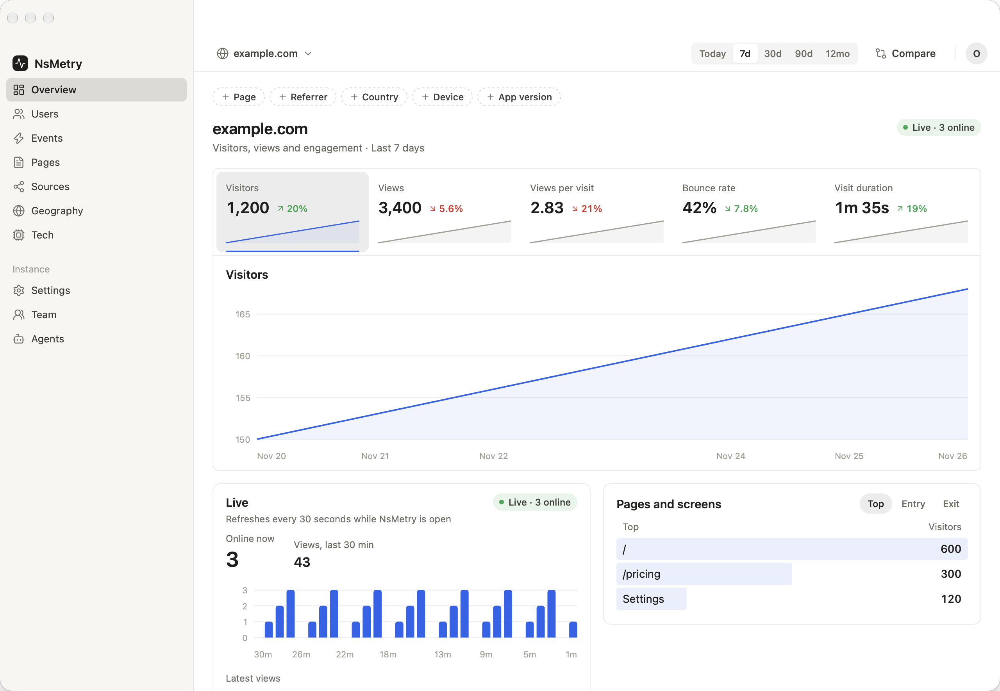

<p align="center">
  <picture>
    <source media="(prefers-color-scheme: dark)" srcset="app/shots/insights-desktop-dark-overview.png">
    
  </picture>
</p>

<p align="center">
  <a href="https://github.com/hayaran/Edgemetry/actions/workflows/ci.yml"></a>
  <a href="https://github.com/hayaran/Edgemetry/releases"></a>
  <a href="LICENSE"></a>
  <a href="https://workers.cloudflare.com/"></a>
  
  <a href="https://hayaran.github.io/Edgemetry/"></a>
</p>

# NsMetry

Privacy-first analytics for **your own fleet of apps and websites**, on
Cloudflare's free plan. One Worker and one D1 database in your Cloudflare
account; no cookies, no consent banner, no bill.

It is sized for one person or a small studio: a handful of apps with a few
thousand daily users between them, a few websites, and a long tail of quiet
side projects — about a hundred sites on one free account (see
[How it stays free](#how-it-stays-free)). You read it in the NsMetry app, on
the web, the desktop or your phone, or you ask your AI agent.

**[Try the demo →](https://hayaran.github.io/Edgemetry/)** — the real app,
running on made-up traffic on your own device. Nothing to sign in to, nothing
sent anywhere. Press a row and every panel narrows.

[](https://deploy.workers.cloudflare.com/?url=https://github.com/hayaran/Edgemetry)

## What you get

- **App analytics**: daily, weekly and monthly active users, new users, day
  and week retention cohorts, custom events with their properties, and app
  versions — from an anonymous install id that is hashed per site before it is
  stored
- **Web analytics**: visitors, page views, views per visit, bounce rate and visit
  duration, each with a previous-period comparison, from a ~2 KB script on your
  own domain
- **Stackable filters**: press any row and *every* panel narrows at once —
  screens in Germany, referrers on mobile, events on app version 2.4
- **Breakdowns** by page or screen, entry and exit page, referrer, country, browser,
  OS, device, screen size, app version and UTM tags, and a world map served from
  your own Worker
- **Realtime**: who is on now, the last thirty minutes, and the latest views
- **Apps for every screen**: the same NSH app on the web (served by your
  instance), macOS, Windows, Linux, iOS and Android, in light and dark
- **No passwords**: you sign in with a code sent to your email; invite other
  emails as read-only viewers of the sites you pick
- **Your AI agent reads it too**: a built-in MCP server with OAuth, so Claude,
  Cursor or any MCP client can answer "how did the launch go?" from your data,
  with exactly the access of the person who connected it
- **Unlimited history** — daily rollups are never deleted
- **No cookies, no fingerprinting, no personal data at rest, and no third-party
  requests** from any browser or app. The only call this project makes to anyone
  is a nightly release check from the Worker, and
  [`UPDATE_CHECK: "off"`](#configuration) stops that

## Getting started

### 1. Deploy

Click the button. Cloudflare signs you in, copies this repository into your own
GitHub or GitLab account, **creates the D1 database**, and deploys the Worker,
with CI/CD wired so that every push to your copy redeploys. There is no API
token to paste.

The build downloads the web app for the version you deploy from this project's
[GitHub release](https://github.com/hayaran/Edgemetry/releases)
(`nsmetry-web.tar.gz`, checked against the release's `sha256sums`), so the
deploy needs no NSH toolchain — see [The web app](#the-web-app).

### 2. Give it a hostname

A fresh Worker has no route. In the Cloudflare dashboard: your Worker →
**Settings** → **Domains & Routes** → **Add custom domain**, for example
`stats.example.com`. Cloudflare creates the DNS record.

Use a domain you own rather than `*.workers.dev`: ad blockers and DNS filters
block that shared hostname wholesale, which silently costs you events, and WAF
rules cannot attach to it. If you turn `workers.dev` on for a quick look, turn it
off again — [POST-DEPLOY.md](POST-DEPLOY.md#first-confirm-what-getting-started-already-did)
explains why.

### 3. Name the administrator

There are no passwords and no setup form. The one administrator is whoever
reads the mailbox named by `ADMIN_EMAIL`. In **your copy** of the repository,
edit `wrangler.jsonc`:

```jsonc
"ADMIN_EMAIL": "you@example.com",
```

and commit; the push redeploys. (Setting it only in the Cloudflare dashboard
works until the next deploy, which puts back the value in `wrangler.jsonc`. If
your copy is public and you would rather not publish the address, any address
you read works, such as a `+analytics` alias.) Until it is set, sign-in answers
"not set up yet" — nobody can claim the instance in the meantime.

### 4. Set up email (or don't, yet)

Sign-in codes are delivered by the first of these that is configured:

1. **SMTP**, from any mailbox provider (Fastmail, Gmail with an app password,
   SES, …):

   ```bash
   npx wrangler secret put SMTP
   # {"host":"smtp.example.com","port":465,"secure":true,"user":"me@example.com","pass":"…","from":"NsMetry <me@example.com>"}
   ```

2. **Cloudflare Email Sending**: onboard a domain with
   `npx wrangler email sending enable example.com`, uncomment the `send_email`
   binding named `EMAIL` in `wrangler.jsonc`, and set `MAIL_FROM` to an address
   on that domain.

3. **Nothing**: the code is written to the Worker's logs instead, and the
   sign-in screen says so. Read it with `npx wrangler tail`, or in the Cloudflare
   dashboard under your Worker → **Logs**. Only someone with access to your
   Cloudflare account can read those, which is the person who could change
   `ADMIN_EMAIL` anyway — so this is a fine way to start, and the only thing it
   cannot do is let a viewer you invited sign in without your help.

### 5. Sign in and add a site

Open your hostname, enter `ADMIN_EMAIL`, and type the code. Then add a site
from the site switcher: a website's domain (`example.com`) or an app's name
(`my-app`). **Settings** shows how to install it, already filled in for your
instance — see [Installing it](#installing-it).

### Deploying from a terminal instead

```bash
npm install
# put your settings in .env (gitignored); scripts/deploy.mjs passes them to the Worker:
#   ADMIN_EMAIL=me@example.com
#   MAIL_FROM=noreply@example.com     # optional: Cloudflare Email Sending, domain onboarded first
#   CLOUDFLARE_ACCOUNT_ID=...         # optional: when your login has several accounts
npm run deploy
```

Wrangler creates the D1 database on the first deploy. It also turns on the
`*.workers.dev` URL, so add your own domain and set `"workers_dev": false`
afterwards. With the `nsh` CLI on your `PATH` the deploy builds the web app from
`app/` instead of downloading it.

## Before you rely on it

**→ [POST-DEPLOY.md](POST-DEPLOY.md)** is the checklist: a hostname you control
with `workers.dev` off, making sure you can always get a sign-in code, checking
the rollups run, and the optional hardening. Each step is marked required,
recommended or optional.

## Installing it

Every site has an install panel under **Settings** with these, filled in for it.

### In a website

```html
<script defer src="https://stats.example.com/em.js" data-domain="example.com"></script>
```

It counts page views (single-page apps included) by itself. Custom events:
`nsmetry('signup')`. The script's name is yours to choose — any
`/<name>.js` on your instance serves it, and the beacon goes to `/<name>`, which
helps against ad-block lists.

### In an app

Register the app as a site by name (`my-app`), then pick a client:

- **NSH apps**: `nsh add nsmetry` — screen views from your navigation, an
  anonymous install id, the app version from `nsh.json`, and flushing when the
  app goes to the background. See [sdk/nsh](sdk/nsh/README.md).
- **JavaScript** (browser apps, Node, Electron, React Native, Bun, Deno,
  Workers): `npm install nsmetry`. See [sdk/js](sdk/js/README.md).
- **Anything else**: the HTTP API. One request per flush of up to 50 events:

  ```bash
  curl -X POST https://stats.example.com/api/events/batch \
    -H 'content-type: text/plain' \
    -d '{"site":"my-app","events":[{"name":"screen_view","url":"/settings","user_id":"<install id>","app_version":"2.4.1"}]}'
  ```

  [docs/sdk.md](docs/sdk.md) has the rules a client should follow (batching,
  retries, the install id) and [docs/api.md](docs/api.md) the whole contract.

Sending a `user_id` — a random id made once per install — is what turns on
active users and retention. It is hashed with a per-site secret before it is
stored; the raw value never reaches the database.

### With an AI agent

**Settings → Install → AI agent** gives you a prompt to paste into Claude Code,
Codex or Cursor. It carries everything the agent cannot know — your instance,
the site key, and the batching rules that keep you inside the free plan — and
the agent picks the right client for the project and wires it in.

## Reading it

### The apps

The same app runs everywhere, built with [NSH](https://nsh.dev):

| | Where |
|---|---|
| **Web** | Your instance's own address. The Worker serves it, so there is nothing to install and nothing to point at a server |
| **macOS, Windows, Linux** | `nsmetry-macos-arm64.zip`, `nsmetry-windows-x86_64.zip`, `nsmetry-linux-x86_64.tar.gz` on the [latest release](https://github.com/hayaran/Edgemetry/releases/latest) |
| **Android** | `nsmetry-android.apk` on the latest release |
| **iOS** | `nsmetry-ios-unsigned.ipa` to sideload with your own Apple ID (AltStore, Sideloadly), or `nsmetry-ios-simulator.zip` for the Simulator |

On the desktop and mobile apps you type your instance's address once, then sign
in with an emailed code like on the web. Typing `demo` as the address, or
pressing **Try the demo**, opens the on-device demo instead.

### Inviting viewers

Under **Team**, the administrator invites an email and ticks the sites it may
read. Nothing is sent: tell them the address, and they sign in with a code like
you do. A viewer sees only their sites, read-only, in the apps and through their
agents alike. Removing someone signs them out everywhere and disconnects their
agents. Permissions are enforced by the server, not by hiding buttons.

| Role | Can do |
|---|---|
| **Administrator** (`ADMIN_EMAIL`) | Everything: sites, people, every site's data |
| **Viewer** | Read the sites they were granted |

### With your AI agent (MCP)

Your instance is an MCP server at `https://stats.example.com/mcp`, protected by
OAuth 2.1. Connecting a client opens a browser where you sign in with an emailed
code; the agent then gets read-only access to exactly the sites you can see.

```bash
claude mcp add --transport http nsmetry https://stats.example.com/mcp
```

Cursor, Claude Desktop and others are under **Agents** in the app, with a
ready-to-paste config for each. The tools are `list_sites`, `get_summary`,
`get_breakdown`, `get_timeseries`, `get_realtime`, `get_active_users`,
`get_retention`, `get_events` and `get_event_properties`. **Agents** also lists
what is connected and disconnects it.

### Scripts

Everything the apps show comes from the HTTP API in [docs/api.md](docs/api.md),
with a bearer token from the same email sign-in.

## How it stays free

NsMetry is designed to run **a hundred sites and apps on one free Cloudflare
account**. The free plan allows, per UTC day, 100,000 Worker requests, 100,000
D1 rows written and 5,000,000 D1 rows read. The target (`src/budget.ts`) is
**half of each**: the other half is headroom for a launch day, a crawler, or a
second person watching the realtime panel. The design itself aims lower still,
at 40,000 requests, 40,000 rows written and 300,000 rows read (`DESIGN_CAPS`).
`test/budget.test.ts` enforces both. It replays a full fleet's day through the
real Worker against a metered D1, counting every statement's `rows_read` and
`rows_written`, and fails if any of the three reaches the target or passes a
cap. When the test fails, make the change cheaper; never raise either.

### The fleet the budget is sized for

| | Sites | Traffic per day |
|---|---|---|
| Apps | 6 | 300 to 2,000 daily users each, 6,300 in all, about 85% of them returning; one to three sessions of 1 to 30 minutes per user, about 18 events each (112,857 in all), sent by the real SDK queue (25,955 flushes, about 4 events each) |
| Websites | 6 | 200 to 700 pageviews each (2,700) |
| Quiet sites | 88 | 0 to 30 pageviews each (1,446) |
| Console | | Realtime panel polled every 30 s from 09:00 to 17:00, and 40 loads of the app's screens as `app/api.ts` builds them (overview, one deeper screen, and for apps the events list, an event's detail, active users and retention; settings one load in four), across today, 7d, 30d, 90d and 12 months, a quarter of them filtered, each also replayed against 729 days of history |

Measured on that day (`npx vitest run test/budget.test.ts`):

| | Requests | Rows written | Rows read |
|---|---|---|---|
| App ingest (25,955 flushes) | 25,955 | 25,993 | 1,597 |
| Website and quiet-site ingest | 4,146 | 4,157 | 1,104 |
| Fold (cron every 10 minutes, and its units) | 296 | 2,895 | 70,679 |
| Nightly (00:00–00:30 runs and the 00:25 backstop) | 39 | 209 | 3,042 |
| Realtime panel (960 polls) | 960 | 8 | 7,866 |
| Dashboard, today (307 requests) | 307 | 0 | 4,303 |
| Dashboard, two years of history | (counted above) | 1 | 2,486 |
| **Day total** | **31,703** | **33,263** | **91,077** |
| Design caps | 40,000 | 40,000 | 300,000 |
| Target (half the free plan) | 50,000 | 50,000 | 2,500,000 |

Requests and rows written are almost all ingest: one of each per request, which
no design can go below. Rows read are mostly the fold reading each raw row once
and looking each new app user up once. A cron with nothing to fold reads one row
and writes nothing.

### How it gets there

- **One raw row per request.** `/api/events/batch` stores a flush of up to 50
  events as one raw row, the events packed as JSON. D1 bills writes per row, so
  a ten-event flush costs what one pageview costs.
- **Raw tables are per hour, keyed `(site_id, ts, k)`, and expire by `DROP`.**
  Every read of raw rows is a seek to one site's rows after a cursor. A table is
  dropped once every site's fold has moved past it and it ended over 25 hours
  ago. `DROP TABLE` is DDL, so expiry writes no rows.
- **Each site keeps one `day_state` row for today.** Every ten minutes the cron
  plans *units* of at most 300 raw rows and hands each to the Worker itself
  (`POST /internal/fold`, through the `SELF` service binding in
  `wrangler.jsonc`), so each unit has a request's CPU time. A unit reads each of
  its sites' rows after the site's cursor, folds them into the state — totals,
  hourly and ten-minute series, every dimension's counts, today's visits, the
  filter cube, event and property counts, today's app users — looks new users
  up in `app_users` once, and writes the state back only if no one else moved
  its cursor. A quiet site costs nothing. A state over 1.8 MB is split across up
  to 16 rows.
- **Finished days are dyadic blocks.** After midnight the fold turns
  yesterday's state into its level-0 block in `blocks` (top 500 values per
  dimension plus "(other)", top 100 events, the day's app users, the filter
  cube, per-filter answers, retention counts), and builds every higher level
  whose period ended: level *k* covers 2^*k* days and is built from its two
  halves. Any range is then at most two blocks per level, about 20 rows for two
  years, read one query per level.
- **Readers fold the tail in memory.** Today is the stored state plus the rows
  after its cursor (at most ten minutes of them), folded in the request and not
  written. No report writes a row.
- **Realtime asks only for what is new.** The panel passes the previous
  answer's `cursor` as `since`; the Worker reads the rows after it, and keeps
  who is online in the isolate between polls (or reads it from the state).

#### The `SELF` binding

`wrangler.jsonc` binds the Worker to itself as `SELF` with
`"service": "nsmetry"`. **If you rename the Worker, rename the service there
too.** Without a working binding nothing breaks, but each cron run folds only
one unit inline instead of up to 45 in parallel, which keeps up with a few quiet
sites and falls behind a busy fleet.

### Upgrading from the earlier storage

Nothing is copied or deleted when an existing deployment takes this version,
and `SCHEMA_VERSION` does not change. The first cron run records tomorrow as the
`blocks_from` setting. Days before it keep being answered from the older
rollups (`stats_daily`, `stats_cube2`, `app_daily`), which are kept; from it on,
from `day_state` and `blocks`. The older hourly rollups (`stats_hourly`) are no
longer written and are dropped once their retention has passed. A range that
crosses the cutover is answered from both, each day from one.

One number changes meaning at the cutover: the older daily rollup's "visits"
of a page or a profile value were summed over hours (a visitor seen in three
hours counted three times). From the cutover a page's number is the visitors who
viewed it, and a country's, browser's or referrer's the visits that started
with it, the same as today has always shown.

### What is exact and what is approximate

- **Exact:** visitors, visits, pageviews, bounce rate, time, events, DAU, new
  users, retention, and every series.
- **Rankings** are exact unless a day had more than 500 values of a dimension or
  100 event names; then the rest is folded into "(other)" and the answer says
  `approx: true`.
- **Event users and a value's visitors over a range** are distinct per day and
  summed over the days.
- **Under a filter**, visitors and event users are distinct per combination of
  dimensions and summed (an upper bound), visits are counted at their entry, and
  a filter on a page counts the visits that started there. Filters work on
  ranges of up to 31 days.
- **WAU, MAU and the users of a range** are the union of the days' user sets,
  exact; for a block with more than 100,000 users the set is a HyperLogLog
  sketch (about 1.6% error).
- **Comparison with the previous period** stops at the same time of day when
  the range ends today: `range=today&cmp=1` at 14:20 compares with yesterday
  until 14:20, not all of yesterday.

A visit is one visitor's pageviews inside a UTC day. With no session id stored
that is the most this can honestly claim, and it makes visits and daily unique
visitors the same number.

`FILTERS: "off"` in `wrangler.jsonc` now only affects days before the cutover;
the fold keeps each day's filter data within the block's size budget, and leaves
out the per-filter answers first, then the cube, when a day would pass it.

### The graph API

The dashboard is a client of four public endpoints; nothing it can show is
unavailable to a script. All of them take `site`, `range`
(`today`/`7d`/`30d`/`90d`/`12mo`, or explicit `from`/`to`), `cmp=1` for a
previous-period comparison, and `f` for the filter stack.

```
GET /api/summary    ?range=30d&cmp=1     → totals, previous, and a per-metric series
GET /api/timeseries ?metric=visitors     → [{ label, cur, prev }]
GET /api/breakdown  ?dim=path,country    → one ranking per dimension, in one trip
GET /api/realtime   ?since=<cursor>      → { online, minutes: […30], recent: […], cursor }
```

The app reports take the same `site` and `range`:

```
GET /api/active-users                     → DAU per day, WAU, MAU, new users
GET /api/retention  ?cohort=day|week      → how many of each cohort came back
GET /api/events                           → event names by count
GET /api/event-properties ?event=purchase → each property's values by count
```

Filters are `f=dim:value` pairs, comma separated, values percent-encoded.
Several values of one dimension mean *either*; two dimensions mean *both*:

```
/api/breakdown?dim=path&range=30d&f=country:DE,country:FR,device:Mobile
```

Filterable dimensions are `path`, `referrer`, `country`, `browser`, `os`,
`device`, `screen`, `app_version` and the three `utm_*` tags. Rankings can also be asked for
`entry`, `exit` and `event`.

## Privacy and GDPR

There is no cookie and no `localStorage` on your websites. A web visitor is
counted as:

```
sha256(daily_salt + site_id + ip_address + user_agent)
```

- The **salt is random per UTC day** and deleted two days later. Once it is gone,
  that day's hashes cannot be recomputed or correlated with any other day —
  the same approach Plausible uses.
- The **raw IP address is never stored**. It exists only in memory long enough to
  compute the hash.
- **Raw event rows are dropped within 24–48 hours.** After that only aggregate
  counts remain, with no visitor identifiers at all.
- Only the referrer's **hostname** is kept, never the full referring URL, which
  routinely carries search terms and session tokens.

Because there is no cookie and no personal data stored, this does not require a
consent banner under GDPR or ePrivacy. And since you deploy to your own
Cloudflare account on your own domain, there is no third-party processor to
disclose. **This is not legal advice** — if you operate under strict
interpretation, check with your own counsel.

Apps that send a `user_id` (an anonymous install id the app makes up, not an
account or a device identifier) are stored as a truncated SHA-256 of a per-site
secret, the site and that id: stable enough to count active users and
retention, useless for linking a person across sites. Neither the raw id nor the
secret is ever stored or returned.

## Configuration

Set in `wrangler.jsonc` under `vars`:

| Variable | Default | Notes |
|---|---|---|
| `ADMIN_EMAIL` | *(empty)* | **Required.** The administrator's email; see [Name the administrator](#3-name-the-administrator). Changing it and redeploying moves the administrator role to another address. |
| `MAIL_FROM` | *(empty)* | Sender for the Cloudflare Email Sending binding, if you use it. |
| `HOURLY_RETENTION_DAYS` | `7` | How long hour-resolution data is kept. Daily rollups are kept forever. |
| `FILTERS` | `on` | Writes the filter cube that lets every panel narrow at once. `off` trades filtering for a smaller budget. |
| `UPDATE_CHECK` | `on` | Once a day the nightly cron asks GitHub for the newest NsMetry release, so the app can say whether you are behind. `off` makes no such request. |

And one secret, `SMTP`, for [email](#4-set-up-email-or-dont-yet). The tracker
script's address shown in install snippets can be overridden under
**Settings** in the app, for an instance that renamed the script or moved it
to another hostname.

## The web app

The Worker serves the NSH web build from its static assets
(`app/dist/web/nsmetry`, `assets` in `wrangler.jsonc`). Static files cost no
Worker requests; the API, MCP, OAuth and the tracker's `/<name>.js` and
`POST /<name>` reach the Worker first, and it hands the app's own scripts back
with their precompressed Brotli copies (`src/assets.ts`).

Before every `wrangler deploy` and `wrangler dev`, the build step
(`scripts/web-package.mjs`) makes sure that directory holds the app:

1. A build that is already there is kept (`NSMETRY_WEB=rebuild` replaces it).
2. With `nsh` on `PATH`, it builds `app/` with `app/build-web.sh`.
3. Otherwise it downloads `nsmetry-web.tar.gz` for the version in
   `package.json` from this project's GitHub release and checks it against the
   release's `sha256sums`. A fork that publishes its own releases points
   `NSMETRY_WEB_URL` at its own archive.
4. If none of that works, it writes a one-page placeholder saying so, and the
   deploy still succeeds: the API, the tracker and MCP do not depend on it, and
   the desktop and mobile apps keep working.

This is why the release workflow publishes the web package on every tag: the
deploy button, Workers Builds and anyone without NSH take the web app from
there rather than from 15 MB of generated files committed to the repository.

## Development

```bash
npm install
npm run dev          # the Worker and the web app on http://localhost:8787
npm run typecheck
npm test             # the Worker, inside the real Workers runtime against a real D1
npm run test:sdk     # the JavaScript SDK
nsh test             # the app's headless tests
npm run build:web    # rebuild the web app (needs nsh)
```

`npm run dev` needs `ADMIN_EMAIL`: put it in a `.dev.vars` file
(`ADMIN_EMAIL=you@example.com`). With no mail configured the sign-in code is
printed in the terminal. Or press **Try the demo**: the app then talks to an
NsMetry that lives on the device (`app/demo.ts`), seeded so everyone sees the
same numbers, with dates relative to today so it never goes stale. That is also
what the [public demo](https://hayaran.github.io/Edgemetry/) runs, published to
GitHub Pages by `.github/workflows/demo.yml`.

### Generate traffic

```bash
npm run seed
npm run seed -- --url https://stats.example.com --domain example.com --events 500
```

posts synthetic page views and events through the real ingest endpoint. To fill
a dashboard with history, write it directly and fold it:

```bash
npm run seed -- --days 45 --domain example.com
npx wrangler d1 execute nsmetry --local --file .seed.sql
curl "http://localhost:8787/cdn-cgi/handler/scheduled?cron=20+0+*+*+*"
```

### Testing the rollups

Cron triggers do not fire under `wrangler dev`; trigger them by hand:

```bash
curl "http://localhost:8787/cdn-cgi/handler/scheduled?cron=5+*+*+*+*"    # hourly
curl "http://localhost:8787/cdn-cgi/handler/scheduled?cron=20+0+*+*+*"   # daily
```

Both only process *completed* hours and *finished* days.

### Releasing

Tag `vX.Y.Z` (matching `package.json` and `nsh.json`). `.github/workflows/release.yml`
builds the web package and the macOS, Windows, Linux, Android and iOS apps and
publishes them with a `sha256sums`; its header lists the signing secrets
(an Android keystore, and optionally an NSH package key for in-app updates).

## Updating a deployment

**Deploys never touch your data.** A deploy replaces the Worker code and the web
app; the D1 database is a separate resource, and the schema migrates itself
(`CREATE TABLE IF NOT EXISTS`, and `ALTER TABLE ADD COLUMN` for new columns) on
the first request.

### Knowing there is something to take

The deploy button *imports* this repository rather than forking it, so GitHub
never tells your copy it is behind. The instance does: once a day the Worker
asks GitHub for the newest release, and the app's account menu says how many
releases you are behind, with a link to the notes. Only the administrator sees
it. `UPDATE_CHECK: "off"` stops the check.

### Taking the update

**Actions → Update NsMetry → Run workflow**, in your copy of the repository. It
fetches upstream, composes the new version as one ordinary commit, and opens a
pull request; CI runs on it, and merging is what deploys. Set the repository
variable `AUTO_UPDATE_PR` to `on` to have it open the pull request by itself;
the deploy still waits for you to merge.

The commit replaces every tracked file with upstream's copy, which is what lets
it apply to an imported repository. Your data and Cloudflare configuration are
untouched, but if you edited files in your copy — `ADMIN_EMAIL` in
`wrangler.jsonc`, for one — the diff shows them going back. Put them back in the
pull request before merging.

By hand, from a clone:

```bash
git remote add upstream https://github.com/hayaran/Edgemetry.git
git fetch upstream main && git switch -c update && git reset --hard upstream/main && git reset --soft main && git commit -m "Update NsMetry"
```

### One footgun worth knowing

On your first `wrangler deploy`, Wrangler writes the new `database_id` back into
`wrangler.jsonc`. Do not commit that line to a public fork — see
[POST-DEPLOY.md](POST-DEPLOY.md#4-keep-database_id-out-of-a-public-fork).

## Known limitations

- **A GitHub or GitLab account is required for the deploy button.** The terminal
  route does not need one.
- **Updates are something you take**: the app tells you, a workflow opens the
  pull request, and merging is yours to do.
- **Web visitors over several days are summed daily totals**, because the
  visitor hash's salt rotates daily: someone visiting on Monday and Tuesday
  counts twice. App users with a `user_id` do not have this problem.
- **All bucketing is UTC.**
- **Filtering by a path narrows to the visits that started there.** Page views
  under that filter are exact.
- **Time on site excludes the last page of a visit**, for want of an unload beacon.
- **Screen size is bucketed** into four ranges; the exact width is never stored.
- **The ingest endpoint is public**, as it must be. Known bots are dropped before
  any write; a Cloudflare rate-limiting rule on it is the answer to deliberate junk.
- **The event detail's trend chart** waits for `GET /api/event-series`, which the
  Worker does not serve yet; the app says the trend is unavailable.

## Roadmap

- Event trends over time (`/api/event-series`)
- Per-site timezone
- Public, shareable dashboards
- CSV export
- Scheduled email reports

## Prior art

[Counterscale](https://github.com/benvinegar/counterscale) established this
category and is well worth your consideration. The main differences here are
storage and setup: Counterscale uses Workers Analytics Engine, which caps
retention at 90 days and needs an API token pasted in at install time. NsMetry
uses D1, which keeps history indefinitely and needs no token, and adds app
analytics, the native apps and the MCP server.

## Author

Built by Nitin Hayaran — [@nitinhayaran](https://x.com/nitinhayaran) on X, where
I post about what goes into this.

## License

MIT — see [LICENSE](LICENSE).
